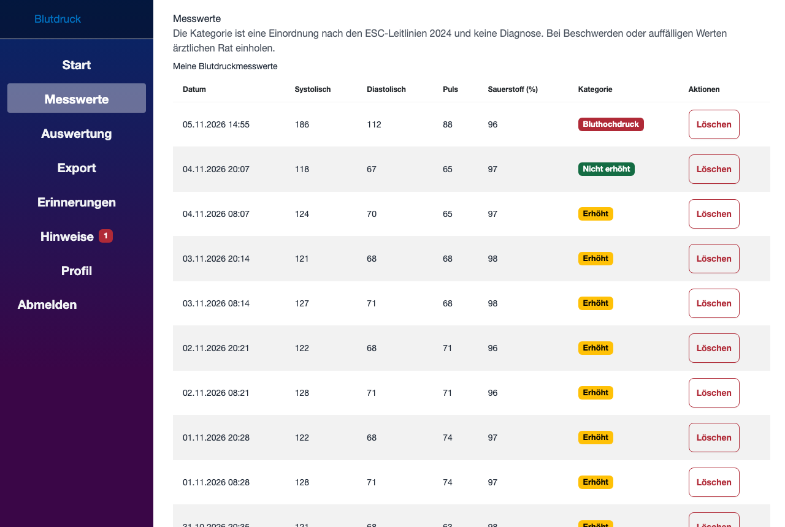
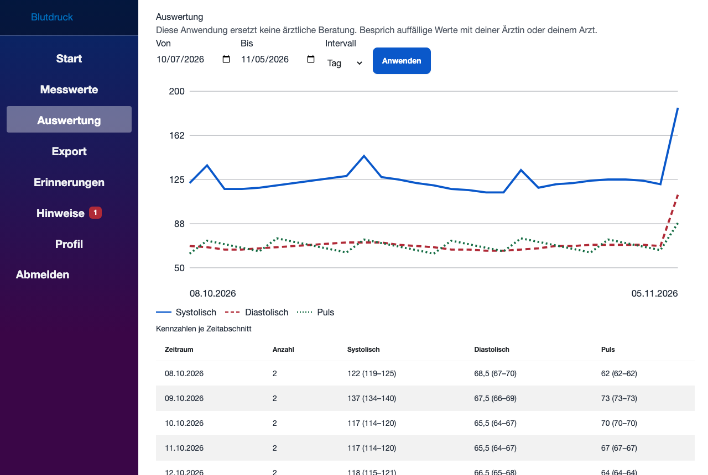
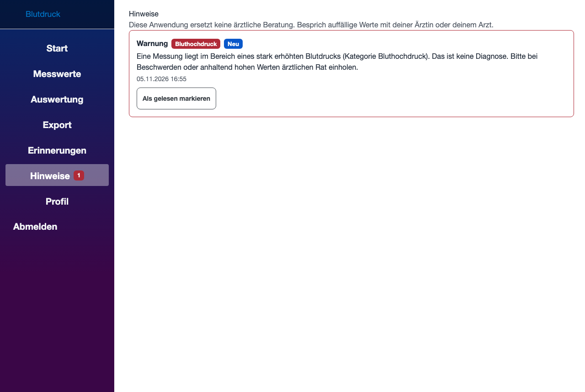
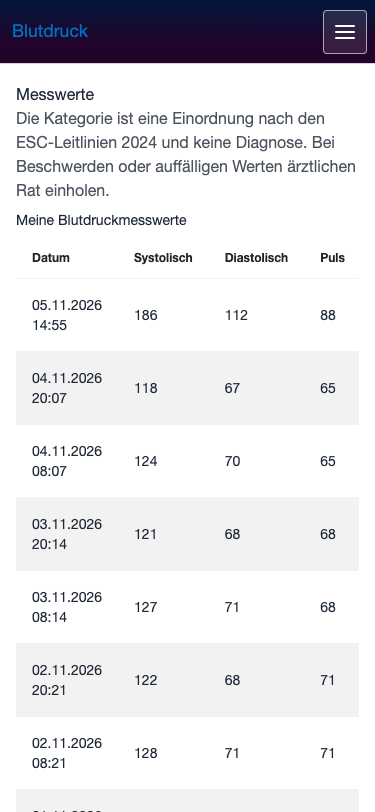
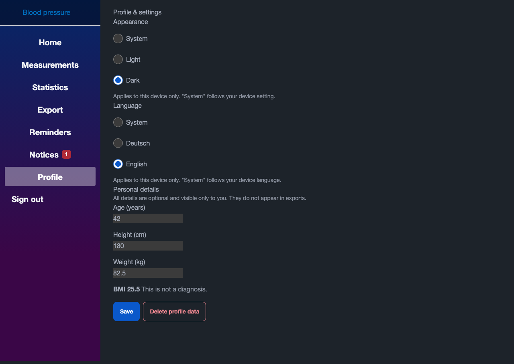
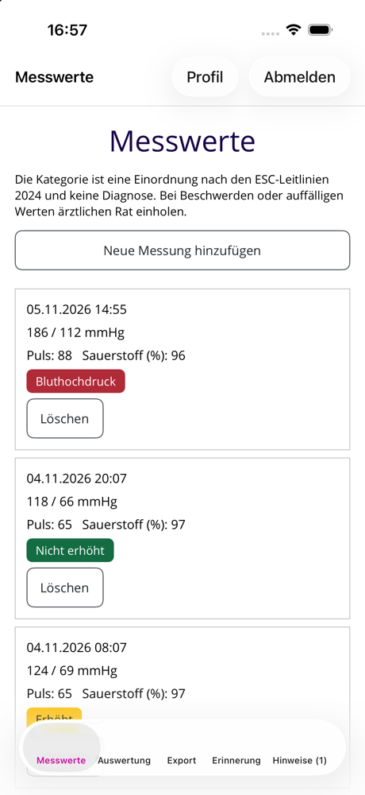
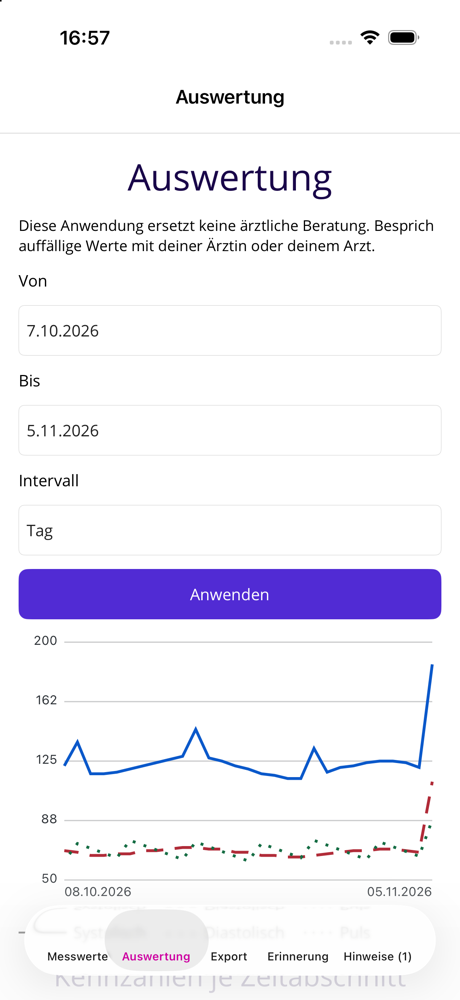
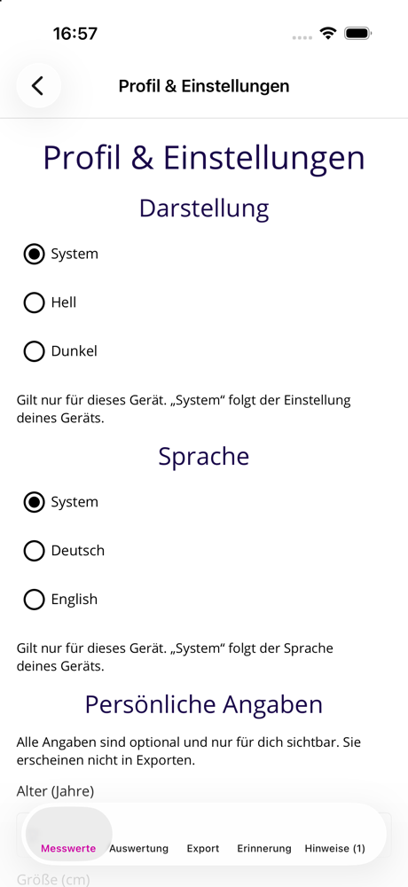

# CleanArchitecture App – Blutdruck-Tagebuch


Web API mit .NET 10 (Clean Architecture, DDD, Wolverine, EF Core 10, PostgreSQL), eine Blazor-WebAssembly-Oberfläche und eine .NET-MAUI-App (iOS, Android, Mac Catalyst). Nutzer erfassen Blutdruckwerte, sehen die Einordnung nach den **ESC-Leitlinien 2024** (nicht erhöht / erhöht / Bluthochdruck, ausdrücklich keine Diagnose), werten Verläufe aus, exportieren CSV/PDF, richten Erinnerungen ein und erhalten Hinweise bei stark erhöhten Werten. Darstellung (Hell/Dunkel) und Sprache (Deutsch/Englisch) wählt jedes Gerät selbst.

<p>
  
  
</p>

## Aufbau

| Projekt | Aufgabe |
|---|---|
| `CleanArchitecture.Domain` | Aggregate, Entitäten, Einordnung (ESC 2024), Repository-Schnittstellen – ohne Infrastruktur |
| `CleanArchitecture.Application` | Anwendungsfälle (Wolverine-Handler, CQRS) |
| `CleanArchitecture.Infrastructure` | EF Core, PostgreSQL, Migrationen, Identity |
| `CleanArchitecture.Presentation.API` | REST-API (`/api/v1`), Authentifizierung, Validierung, Export |
| `CleanArchitecture.Contracts` | DTOs und typisierte Refit-Clients, von Web und App genutzt |
| `CleanArchitecture.Presentation.UI` | Blazor WebAssembly (DE/EN, Hell/Dunkel, barrierearm) |
| `CleanArchitecture.Presentation.Maui(.Core)` | MAUI-App; Logik (ViewModels, Texte) im Core ohne MAUI-Abhängigkeit |
| `CleanArchitecture.AppHost`, `.ServiceDefaults` | .NET Aspire zur lokalen Orchestrierung |
| `Tests/` | TUnit (Backend, UI mit bUnit, MAUI-Core) und die Browser-Prüfung `Tests/a11y` |
| `UserStories/`, `docs/adr/` | Specs im OpenSpec-Format (`specs/` dauerhaft, `archive/` abgeschlossen), Architekturentscheidungen |

## Lokal starten

Voraussetzungen: .NET 10 SDK, Docker.

```bash
docker run -d --name bp-pg -e POSTGRES_HOST_AUTH_METHOD=trust -e POSTGRES_DB=bloodpressure -p 5432:5432 postgres:17
```

```bash
ConnectionStrings__bloodpressuredb="Host=localhost;Port=5432;Database=bloodpressure;Username=postgres" \
Cors__AllowedOrigins__0=http://localhost:5296 ASPNETCORE_ENVIRONMENT=Development \
ASPNETCORE_URLS=http://localhost:5000 dotnet run --project CleanArchitecture.Presentation.API --no-launch-profile
```

```bash
dotnet run --project CleanArchitecture.Presentation.UI --no-launch-profile --urls http://localhost:5296
```

In `Development` werden die Migrationen automatisch angewendet. Die API-Adresse der Oberfläche steht in `CleanArchitecture.Presentation.UI/wwwroot/appsettings.json` (`Api:BaseUrl`, hier `http://127.0.0.1:5000`; ein Release-Build braucht HTTPS). Unter macOS belegt AirPlay den Port 5000 auf allen Adressen; die API an `localhost` zu binden (wie oben) setzt sich dagegen durch, ein Aufruf mit `curl localhost` kann trotzdem beim AirPlay-Dienst landen (Antwort 403) – dann `127.0.0.1` verwenden. Alternativ startet `CleanArchitecture.AppHost` (.NET Aspire) PostgreSQL (mit pgAdmin) und die API gemeinsam; die Oberfläche läuft weiterhin separat.

## Tests und CI

```bash
dotnet test --project Tests/CleanArchitecture.Tests        # Backend und Integration (PostgreSQL per Testcontainers, braucht Docker)
dotnet test --project Tests/CleanArchitecture.UI.Tests     # Blazor-Komponenten (bUnit)
dotnet test --project Tests/CleanArchitecture.Maui.Tests   # MAUI-Core und statischer XAML-Zugänglichkeitstest
```

Der GitHub-Workflow `CI` (Pflicht-Check für `main`) baut, führt alle Tests aus, lädt Testergebnisse als Artefakt hoch und bricht bei Paketen mit hoher oder kritischer Schwachstelle ab; neue Pushes brechen laufende Läufe derselben Branch ab. Der Job `A11y` (kein Pflicht-Check) startet API und Oberfläche und prüft jede Seite mit axe-core und Playwright in Hell/Dunkel, Deutsch/Englisch und bei 1280, 375 und 320 px (`Tests/a11y/check.mjs`). Nach erfolgreicher CI veröffentlicht `CD` das Container-Image (siehe unten). Details: `UserStories/specs/ci.openspec.md`.

## Oberfläche (Blazor WebAssembly)

Nach der Anmeldung stehen fünf Bereiche bereit: **Messwerte** (Liste mit Kategorie, Anlegen, Löschen), **Auswertung** (Kennzahlen und Verlaufsdiagramm je Tag/Woche/Monat), **Export** (CSV oder PDF für einen Zeitraum), **Erinnerungen** (bis zu 5 tägliche Uhrzeiten) und **Hinweise** (Warnungen mit Zähler in der Navigation). Texte sind DE/EN; die API-Adresse steht in `CleanArchitecture.Presentation.UI/wwwroot/appsettings.json` (`Api:BaseUrl`), die Browser-Herkunft der UI muss in der API unter `Cors:AllowedOrigins` freigegeben sein.

<p>
  
  
</p>

## Profil & Einstellungen

Web (`/profile`) und MAUI-App (Schaltfläche „Profil“ auf den Messwerten) haben eine Seite mit drei Teilen:

- **Darstellung** (System / Hell / Dunkel): gilt je Gerät und wird lokal gespeichert (Browser: `localStorage`, App: `Preferences`), nicht am Server. Im Web setzt `data-theme` am `<html>`-Element das Schema; ohne Wahl gilt das Systemschema.
- **Sprache** (System / Deutsch / English): gilt ebenfalls je Gerät und wird lokal gespeichert (Browser: `localStorage` `bp.lang`, App: `Preferences` `bp.language`), nicht am Server. „System“ folgt der Browser- bzw. Gerätesprache (Englisch, sonst Deutsch). Der Wechsel wirkt sofort auf Texte, Zahlen- und Datumsformate; im Web bleiben ungespeicherte Eingaben erhalten, die App baut die Oberfläche neu auf (Anmeldung bleibt). Technisch: Das Web nutzt einen eigenen Lokalisierer (`LanguageLocalizer`), weil Blazor WebAssembly die Kultur des Threads beim Start festlegt, und lädt dafür beide Sprachpakete (`loadAllSatelliteResources` in `wwwroot/index.html`).
<p>
  
</p>

- **Persönliche Angaben** (Alter, Größe in cm, Gewicht in kg, alle optional): am Server je Nutzer unter `GET/PUT/DELETE /api/v1/profile`. Gespeichert wird das Geburtsjahr, angezeigt das Alter. Dazu eine BMI-Zahl **ohne** Bewertung und mit dem Hinweis „keine Diagnose“. Die Angaben stehen nicht in Exporten.

## MAUI-App (iOS, Android, Mac Catalyst)

Stand: Anmeldung (Registrieren, Abmelden, gespeicherte Anmeldung im sicheren Speicher), Messwerte (Liste mit Nachladen, Anlegen, Löschen), Auswertung (Kennzahlen und Verlaufsdiagramm je Tag/Woche/Monat) Export (CSV/PDF über den Teilen-Dialog), Erinnerungen (Zeitzone, bis zu 5 Uhrzeiten) und Hinweise (Warnungen, als gelesen markieren, Zähler im Tab-Titel). Barrierefreiheit: statischer XAML-Test in der CI, Geräte-Anleitung in `docs/a11y/maui-screenreader-pruefung.md` (Screenreader-Durchlauf noch offen) (siehe `UserStories/archive/2026-11-05-maui-app-api-anbindung.openspec.md`).

<p>
  
  
  
</p>

- Logik (ViewModels, Sitzung, Texte DE/EN) liegt in `CleanArchitecture.Presentation.Maui.Core` und ist über `dotnet test --project Tests/CleanArchitecture.Maui.Tests` testbar; Entscheidung in `docs/adr/0004-maui-core-und-mvvm-toolkit.md`.
- **API-Adresse:** `CleanArchitecture.Presentation.Maui/appsettings.json` (`Api:BaseUrl`, vor einem Release-Build setzen, nur HTTPS); Debug-Builds nutzen `appsettings.Debug.json` (`http://localhost:5000`, im Android-Emulator automatisch `10.0.2.2`).
- Bauen z. B. für den iOS-Simulator: `dotnet build CleanArchitecture.Presentation.Maui -f net10.0-ios -p:RuntimeIdentifier=iossimulator-arm64` (bei abweichender Xcode-Version zusätzlich `-p:ValidateXcodeVersion=false`).
- iOS/macOS 26+ verlangen die Scene-Lifecycle-Anbindung (`SceneDelegate` plus `UIApplicationSceneManifest` in der Info.plist unter `Platforms/iOS` und `Platforms/MacCatalyst`); ohne sie bricht die App beim Start ab. Geprüft: iOS-26.5-Simulator, iOS-27-Simulator, Mac Catalyst unter macOS 27. Nach Änderungen an der Info.plist `bin`/`obj` des Zielframeworks löschen, sonst bleibt die alte Plist im App-Paket.
- **Android** (geprüft am 2026-11-05: Emulator API 35, Build mit .NET 10 / Android-Workload 36.1): `dotnet build CleanArchitecture.Presentation.Maui -f net10.0-android -p:AndroidSdkDirectory=$HOME/Library/Android/sdk -p:EmbedAssembliesIntoApk=true`. Der Schalter `EmbedAssembliesIntoApk=true` ist für einen per `adb install` installierten Debug-APK nötig; ohne ihn bricht die App beim Start mit „No assemblies found … Fast Deployment“ ab. Die API muss auf `127.0.0.1:5000` lauschen (der Emulator erreicht sie als `10.0.2.2:5000`).
- Windows-Build ist ungeprüft (nur unter Windows baubar).
- Hinweistexte: Der Server liefert sie auf Deutsch; Web-UI und App bilden die Texte bekannter Typen (kritischer Wert, Erinnerung) selbst in der Oberflächensprache, nur unbekannte Typen zeigen den Servertext.

## Container-Image

Nach jedem erfolgreichen CI-Lauf auf `main` veröffentlicht der Workflow `CD` das Image der API in der GitHub Container Registry:

```bash
docker pull ghcr.io/<owner>/bloodpressure-api:latest   # <owner> in Kleinbuchstaben
```

Tags: `latest` und `sha-<Commit>`. Das Image läuft als Nicht-Root-Benutzer und lauscht auf Port 8080.

Konfiguration nur über Umgebungsvariablen:

| Variable | Bedeutung |
|---|---|
| `ConnectionStrings__bloodpressuredb` | PostgreSQL-Connection-String (erforderlich) |
| `Cors__AllowedOrigins__0` | Erlaubte Browser-Herkunft für das Frontend (weitere mit `__1`, ...) |
| `ASPNETCORE_ENVIRONMENT` | `Production` (Standard). Die Migrationen werden nur in `Development` automatisch angewendet. |

Liveness: `GET /alive` (nur "self"-Check, in allen Umgebungen). Der vollständige Health-Check `/health` ist nur in `Development` erreichbar.

## Screenshots

Die Bilder in `docs/screenshots/` zeigen erfundene Beispieldaten. Die Web-Bilder erzeugt `Tests/a11y/screenshots.mjs` (laufende API und Oberfläche wie für `check.mjs`; `cd Tests/a11y && npm ci && node screenshots.mjs`, ggf. mit `A11Y_CHROMIUM`). Die App-Bilder sind Aufnahmen aus dem iOS-26.5-Simulator (iPhone 17) mit denselben Beispieldaten.
